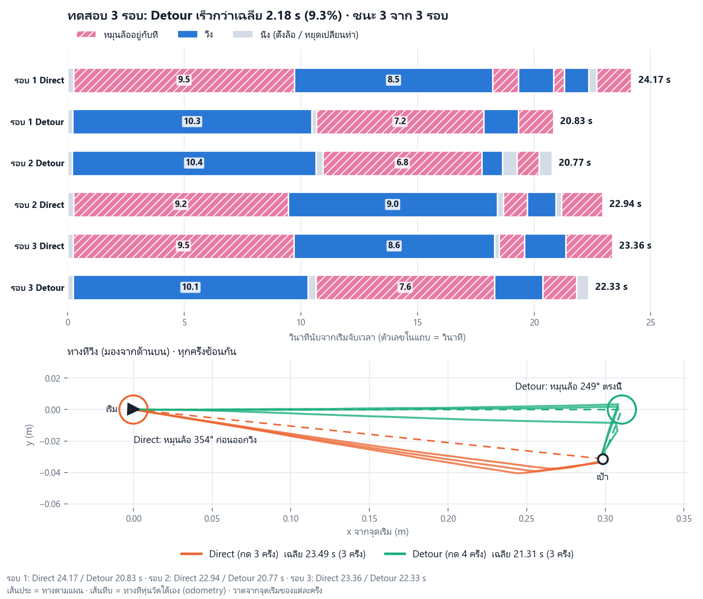

# algorithm_sim — Detour Steer: อัลกอริทึม + ซิมบนคอม (ไม่ต้องใช้ Docker)

อัลกอริทึมตัดสินใจของหุ่น `mor_luam`: **Detour Steer**
หุ่นมีมอเตอร์ตัวเดียว เลี้ยวได้ทางเดียวและต้องหยุดก่อนเลี้ยว ถ้าเป้าอยู่ฝั่งที่ต้องหมุนล้อเกือบรอบ
ให้ **วิ่งไปก่อน เลี้ยวให้น้อยลง แล้วค่อยเข้าเป้า** โดยมีสูตรปิดบอกมุมที่เร็วที่สุด

| ไฟล์ | คืออะไร |
|---|---|
| `docs/algorithm.pdf` (`.tex`, `.html`) | pseudo-code Algorithm 1.1–1.7 + พิสูจน์ + ผลซิม + ผลบนหุ่นจริง |
| `docs/explain_th.md` | อธิบายแบบเข้าใจง่ายสำหรับนำเสนอ (ลำดับการพูด + คำถามที่อาจโดนถาม) |
| `docs/HW04_README_th.md` | รายละเอียดเต็ม: นิยามปัญหา พิสูจน์ ผลเปรียบเทียบ |
| `detour_steer.py` | อัลกอริทึม + ตรวจทฤษฎีบท + benchmark + บันทึกรูป (ไฟล์เดียว) |
| `sim_detour_steer.py` | หน้าต่างซิม: หุ่น 2 ตัว (วิธีเดิม vs Detour Steer) วิ่งแข่งกัน |
| `sim_detour_only.py` | หน้าต่างซิม: Detour Steer ตัวเดียว + แผงแสดงการคิดของอัลกอริทึม |
| `test_current_robot.py` | ตรวจเทียบกับค่าของหุ่นจริง (ทวนเข็ม, v 0.03 m/s, ω 35°/s) |
| `output/` | รูปผลลัพธ์ ซิม และผลทดสอบ 3 รอบบนหุ่นจริง |

ตัวอัลกอริทึมที่รันบนหุ่นจริงอยู่ใน firmware: `firmware/src/algorithm/DetourSteer.cpp`
(และ `nav/WaypointRunner.cpp`, `algorithm/FinalApproach.h`, `algorithm/SteerApproach.h`)

## รันซิมบนคอม (ไม่ต้องใช้ Docker)

ต้องมี Python 3.10+ กับ `matplotlib` (tkinter มากับ Python บน Windows แล้ว)

```bash
pip install matplotlib
cd algorithm_sim
python detour_steer.py              # ตรวจทฤษฎีบท + ตัวอย่าง + benchmark + บันทึกรูปลง output/
python detour_steer.py --no-bench   # ข้าม benchmark (เร็วกว่า)
python sim_detour_steer.py          # หน้าต่างซิม: วิธีเดิม vs Detour Steer
python sim_detour_only.py           # หน้าต่างซิม: Detour Steer ตัวเดียว
python -m unittest test_current_robot
```

บน Ubuntu ถ้าไม่มี tkinter: `sudo apt install python3-tk`

ซิมบนหน้าเว็บ (ไม่ต้องใช้ Docker เหมือนกัน): `python tools/pc_web.py` แล้วเปิด http://localhost:8000 แท็บ "จำลอง"

## ใช้กับหุ่นจริง: แนะนำติดตั้งแบบ Docker

ซิมด้านบนไม่ต้องใช้ Docker แต่ถ้าจะ **build / อัปโหลด firmware ลงหุ่น และใช้ ROS 2**
**แนะนำติดตั้งแบบ Docker ที่สุด** เพราะได้เครื่องมือ (PlatformIO, micro-ROS, ROS 2 Jazzy) เวอร์ชันเดียวกันทุกเครื่อง
ไม่ต้องลงทีละตัว ใช้ได้ทั้ง Windows และ Ubuntu

วิธีติดตั้งทีละขั้น: [`docs/INSTALL_TH.md`](../docs/INSTALL_TH.md) (ภาษาไทย) และ [`docs/install_and_run.md`](../docs/install_and_run.md)

สรุปสั้น (Windows):
1. ติดตั้ง Docker Desktop (WSL 2) และ Git แล้วเปิด Docker Desktop จนขึ้น "Engine running"
2. `git clone https://github.com/Mannaja78520/mor_luam.git` แล้ว `cd mor_luam`
3. `docker\mor_luam.bat fw-build` — build firmware
4. `docker\mor_luam.bat fw-flash -Port COM9` (ครั้งแรกผ่าน USB) หรือ `docker\mor_luam.bat fw-ota -Host <IP>` (ผ่าน Wi-Fi)

Ubuntu ใช้ `./docker/mor_luam.sh` แทน `docker\mor_luam.bat` ด้วยคำสั่งเดียวกัน

## ผลบนหุ่นจริง (ทดสอบ 3 รอบ)

| รอบ | วิธีเดิม | Detour Steer |
|---|---:|---:|
| 1 | 24.17 s | 20.83 s |
| 2 | 22.94 s | 20.77 s |
| 3 | 23.36 s | 22.33 s |
| เฉลี่ย | 23.49 s | 21.31 s (เร็วขึ้น 9.3 %, ชนะ 3/3) |


