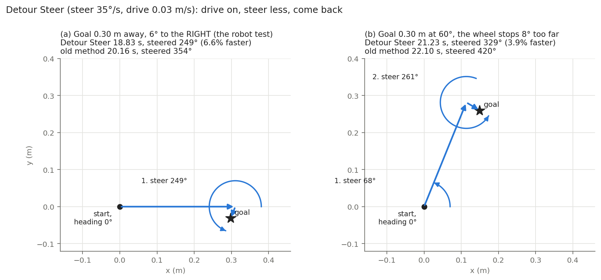
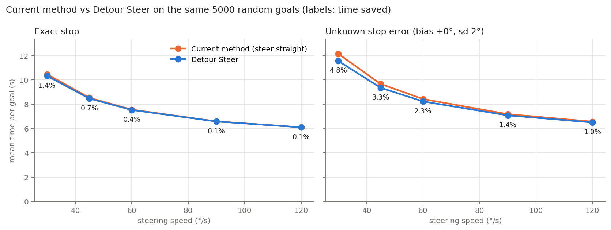
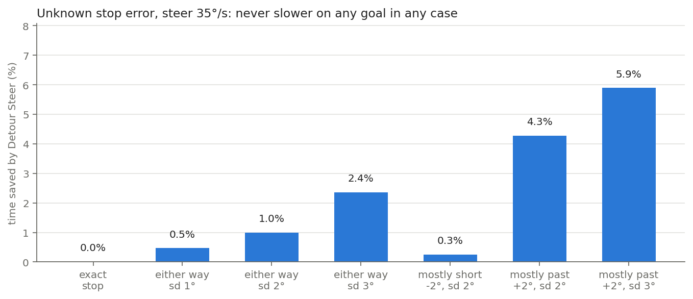
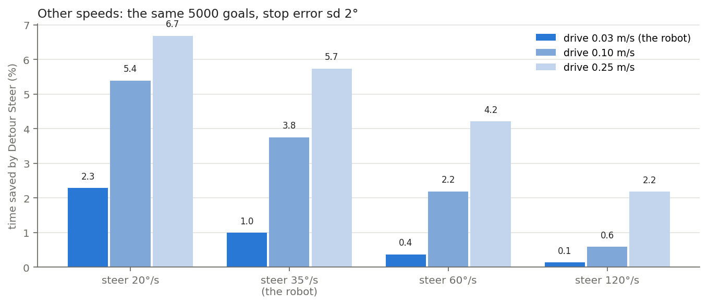
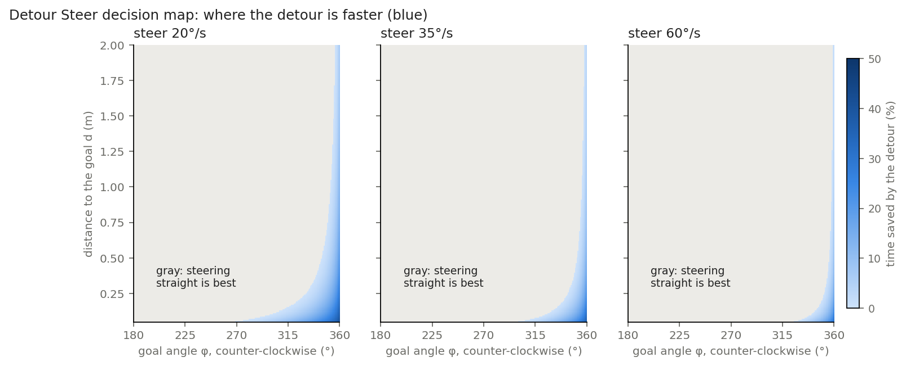
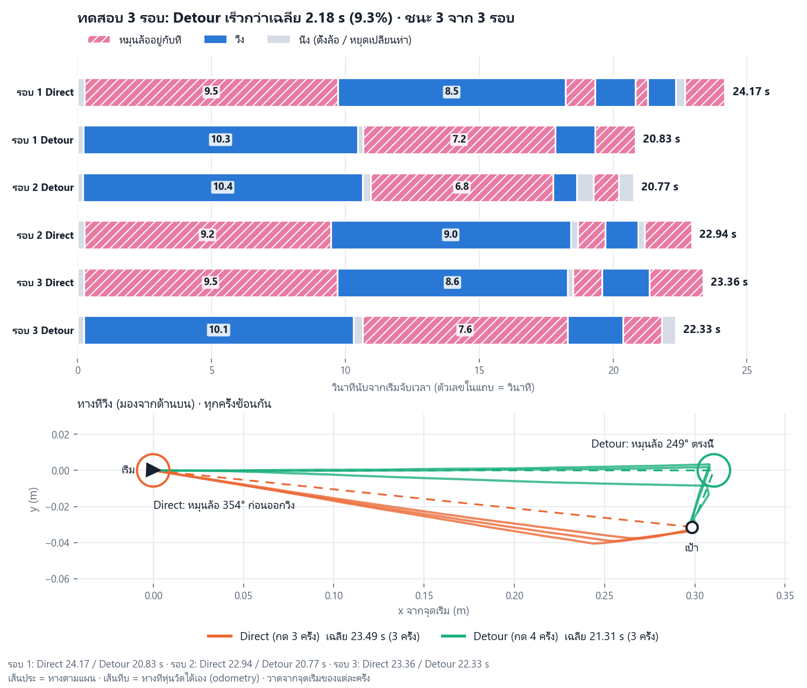
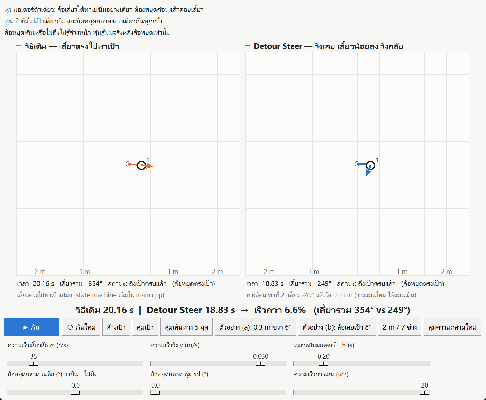
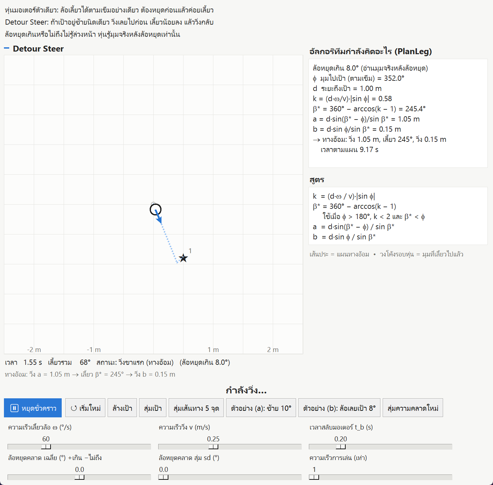

# AUT HW 04 — Detour Steer: อัลกอริทึมสำหรับหุ่นที่เลี้ยวได้ทางเดียว (ทวนเข็มนาฬิกา)

## สถานะปัจจุบัน: กรอบ CCW และแบบจำลองระยะรวม 2 เมตร (27 ต.ค. 2026)

- โค้ด Python, simulator, pseudocode HTML/TeX/PDF ใช้กรอบเดียวกับหุ่นจริง: +x หน้า, +y ซ้าย, heading เพิ่มทวนเข็ม, `unit(h)=(cos h, sin h)` และ `bearing=atan2(dy,dx)`
- ฟังก์ชันใหม่ชื่อ `steer_error`; `cw_error` ยังเป็น alias สำหรับ notebook เก่า แต่ไม่ได้หมายถึงการเลี้ยวตามเข็มของหุ่นจริง
- `RobotConfig()` ใช้ **ค่าที่วัดจากหุ่นจริง**: v = 0.03 m/s, ω = 35°/s, รัศมีถึงเป้า 0.0025 m ผลซิมทุกตารางในไฟล์นี้ทดสอบที่ค่านี้
- ผลที่ความเร็วอื่น (วิ่ง 0.10 / 0.25 m/s, เลี้ยว 20–120°/s) อยู่ในข้อ 6.3
- `measured_robot()` และค่าตั้งต้นของ GUI ใช้ 0.03 m/s / 35°/s; เกณฑ์ถึงเป้าใน GUI 0.0025 m
- ปุ่มตัวอย่างใหม่ **2 m / 7 ช่วง** ใช้จุดชุดเดียวกันทั้ง Direct / Detour ช่วงละประมาณ 0.286 m รวม 2 m ทางตรงเชื่อมจุด (การอ้อมอาจขับจริงไกลกว่า)
- คำนวณแบบอุดมคติด้วย `python detour_steer.py --comparison`: Direct 137.82 s, Detour 110.52 s / 4 detours ขากลับประมาณ 1.96 m ยังไม่รวมเวลา
- รูปเส้นทาง 2 m / 7 ช่วง: `output/fig_route_2m.png` (ซิมที่ความเร็วหุ่นจริง: วิธีเดิม 137.82 s, Detour 110.52 s, เร็วขึ้น 19.8 %)
- ซิมเทียบหุ่นจริง (เป้า 0.30 m, 354°): วิธีเดิม ซิม 20.16 s / จริง 23.49 s (−14.2 %), Detour ซิม 18.83 s / จริง 21.31 s (−11.6 %)
- ซิมแบบใกล้เคียงหุ่น (`RealismConfig`, `run_route_real`): ล้อหยุดขาด 2° (sd 1°), เบี่ยงขวา 5±5°/m, เล็งใหม่ (Alg. 1.7), +1.25 s ต่อการเลี้ยว → เป้า 0.30 m: วิธีเดิม 24.75 s (+5.4 %), Detour 20.22 s (−5.1 %) เทียบหุ่นจริง
- ช่วงที่คาดของ 2 m บนหุ่นจริง (ค่าประมาณ ไม่ใช่ค่าวัด): วิธีเดิม ~157–167 s, Detour ~122–156 s, เร็วขึ้น ~7–26 %
- 3 รอบจับคู่คือ 6 runs; ตัวเลขชุดใหม่นี้เป็น **แบบจำลอง ไม่ใช่ผลวิ่งจริง** รูป `fig_robot_3rounds.png` เป็นหลักฐานชุดสั้นเดิม จึงไม่ใช้แทนผลของเส้นทาง 2 m
- `k<2` เป็นเงื่อนไขให้มีตัวเลือกทางอ้อมเท่านั้น ยังต้องเทียบเวลารวมรวมการหยุด จึงอาจเลือก Direct ได้
- รูปหน้าต่าง `fig_sim.png` / `fig_sim_only.png` เป็นภาพประกอบเวอร์ชันก่อนหน้า รัน simulator ใหม่เพื่อใช้ค่าปัจจุบัน รูปเส้นทาง/decision map สร้างใหม่ด้วยกรอบ CCW

```powershell
python -B test_current_robot.py
python -B sim_detour_steer.py --selftest
python -B sim_detour_only.py --selftest
python -B detour_steer.py --comparison
```

เว็บบนคอมของ mor_luam เปิดได้แม้ไม่มีหุ่น: รัน `docker\mor_luam.bat web` จากโฟลเดอร์ mor_luam แล้วเปิด `http://localhost:8000/`
แท็บจำลองวาง/ลาก/ลบจุดเองได้ เป็นจุดภายในเบราว์เซอร์ ไม่มีการสั่งมอเตอร์ เมื่อเปิดหุ่นจริงเว็บค้นหาและเชื่อมให้อัตโนมัติ


โจทย์จากอาจารย์: **"ทำอัลกอริทึมที่ยังไม่มีในโลก อย่างน้อย 1 อัน"**

งานนี้เสนอ **อัลกอริทึมเดียว: Detour Steer** สำหรับหุ่น `mor_luam`
(`E:/GPS_Localize/old/mor_luam`) ที่มีมอเตอร์ตัวเดียว: หมุนทางหนึ่ง = **เลี้ยวล้อ (ทวนเข็มอย่างเดียว)**,
หมุนอีกทาง = **วิ่งไปข้างหน้า** จึงเลี้ยวกับวิ่งพร้อมกันไม่ได้ และเลี้ยวตามเข็มไม่ได้เลย

แนวคิด: ถ้าเป้าอยู่ "ขวานิดเดียว" ให้วิ่งเลยไปก่อน เลี้ยวน้อยลง แล้ววิ่งกลับมา
มุมที่ดีที่สุดหาได้ด้วย **สูตรปิด (closed form) O(1)** พร้อมพิสูจน์ว่าดีที่สุด
ถ้าทางอ้อมไม่คุ้ม อัลกอริทึมจะทำ **เหมือนวิธีเดิมทุกอย่าง** (เลี้ยวตรงไปหาเป้า)

```
aut_HW_04_detour_steering/
├── detour_steer.py              # ทั้งหมดในไฟล์เดียว: config + อัลกอริทึม + ตรวจทฤษฎีบท + simulator + รูป + benchmark
├── sim_detour_steer.py          # ซิมบนคอม: หน้าต่าง tkinter หุ่น 2 ตัววิ่งแข่งกันให้ดูสดๆ
├── sim_detour_only.py           # ซิมบนคอม อีกเวอร์ชัน: Detour Steer ตัวเดียว + แผงแสดงการคิดของอัลกอริทึม
├── promt.md                     # prompt ที่ใช้สั่งงานนี้
└── output/
    ├── fig_sim.png              # หน้าต่างซิม (ตัวอย่าง a)
    ├── fig_sim_only.png         # หน้าต่างซิมเวอร์ชันตัวเดียว (ตัวอย่าง b: ล้อหยุดเกิน 8° แล้วใช้ทางอ้อม)
    ├── fig_path.png             # เส้นทางของ Detour Steer (2 ตัวอย่าง) เทียบเวลากับวิธีเดิม
    ├── fig_decision_map.png     # แผนที่: ตรงไหนที่ทางอ้อมเร็วกว่า และเร็วกว่ากี่ %
    ├── fig_compare.png          # เทียบกับวิธีเดิม บนเป้าสุ่มชุดเดียวกัน
    ├── fig_noise.png            # ความคลาดตอนล้อหยุดแบบต่างๆ (เกิน / ไม่ถึง / สุ่ม)
    └── fig_robot_3rounds.png    # ทดสอบบนหุ่นจริง 3 รอบ: เส้นเวลา + ทางที่วิ่ง (ข้อ 8)
```

ไฟล์ Python ไฟล์เดียว รันเองได้ (ต้องมี `matplotlib`)

Pseudo-code แบบ MDPI (`.pdf` / `.tex` / `.html`):
[`algorithm/DETOUR_STEERING/algorithm.pdf`](algorithm.pdf)
- Algorithm 1.1 – 1.7 คือส่วนย่อยของอัลกอริทึมเดียวกัน (1.1–1.5 วางแผน, 1.6–1.7 คือวิธีที่หุ่นเลี้ยวและวิ่งแต่ละขา)
- หน้า 4–5 มีทฤษฎีบท, complexity, ผลซิม, ผลบนหุ่นจริง และงานที่ใกล้ที่สุด
- คำอธิบายแบบง่ายสำหรับนำเสนอ: [`algorithm/DETOUR_STEERING/explain_th.md`](explain_th.md)

```
python detour_steer.py              # ตรวจทฤษฎีบท + ตัวอย่าง + benchmark + บันทึกรูป
python detour_steer.py --no-bench   # ข้าม benchmark
python sim_detour_steer.py          # เปิดซิมบนคอม (ดูข้อ 11)
python sim_detour_only.py           # ซิมอีกเวอร์ชัน: Detour Steer ตัวเดียว (ดูข้อ 11.2)
```

---

## 1. นิยามปัญหา

หุ่นอยู่ที่จุด `p` ล้อหันไปทาง `h` ต้องไปเป้า `g` ให้เร็วที่สุด

| สัญลักษณ์ | ความหมาย | ค่าที่ใช้ | ที่มา |
|---|---|---|---|
| `φ` | มุมจากหัวล้อไปเป้า วัด **ทวนเข็ม** `0 … 360°` | — | `cw_error_deg()` ใน `main.cpp` |
| `d` | ระยะถึงเป้า | — | — |
| `v` | ความเร็ววิ่ง | 0.03 m/s | วัดจากหุ่นจริง |
| `ω` | ความเร็วเลี้ยวล้อ | 35 °/s | วัดจากหุ่นจริง (ข้อ 6.1 ทดสอบ 20–120 °/s) |
| `t_s` | เวลานิ่งหลังเลี้ยว | 0.05 s | `STEER_SETTLE_MS = 50` |
| `t_b` | เวลาหยุด + สลับมอเตอร์ วิ่ง → เลี้ยว | 0.2 s | ค่าตั้งใน simulation |
| `tol` | ความคลาดเคลื่อนที่ยอมรับ | 3.5° | `Wheel_STEER_ERROR_TOLERANCE` |
| stop error | ล้อหยุดคลาด: **เกินหรือไม่ถึง** เป้านิดหน่อย ไม่รู้ล่วงหน้า | สุ่ม bias 0°, sd 2° (ทดสอบหลายแบบ ข้อ 6.2) | ค่าตั้งใน simulation |
| `r_goal` | ถือว่าถึงเป้าเมื่อห่างไม่เกิน | 0.05 m | `drive_to_xy.py --tolerance 0.05` |

**ความคลาดตอนล้อหยุด ไม่มีใครรู้ล่วงหน้า** ทั้งหุ่นและอัลกอริทึม:
- หุ่นรู้มุมล้อจริงจาก AS5600 **หลังล้อหยุดแล้วเท่านั้น** แล้ววางแผนใหม่จากตรงนั้น
- อัลกอริทึม **ไม่ได้ใช้** ค่า bias / sd เลย ค่าพวกนี้มีไว้ให้ simulator สุ่มเท่านั้น
- ถ้าหัวล้อคลาดอยู่ใน `±tol` หุ่นวิ่งไปตามหัวจริง (เพี้ยนได้นิดหน่อย)
  ถ้าพลาดเป้าเกิน 5 cm ก็วางแผนแก้ใหม่ เหมือน `drive_to_xy.py` บนหุ่นจริง

กติกาของหุ่น:
- เลี้ยวได้ **ทวนเข็มอย่างเดียว** หัวล้อจึง "เพิ่มขึ้น" อย่างเดียว
- **เลี้ยวกับวิ่งพร้อมกันไม่ได้** (มอเตอร์ตัวเดียว)
- วิ่ง **ไปข้างหน้า** เท่านั้น

มุมทุกมุมในงานนี้วัด **ทวนเข็มนาฬิกา** จากแกน +x ดังนั้นเวกเตอร์หนึ่งหน่วยของหัว `ψ` คือ `(cos ψ, sin ψ)`

---

## 2. วิธีเดิมของ firmware (ใช้เทียบ)

state machine `STEER_TO_HEADING → DRIVE` ใน `main.cpp`: เลี้ยวตรงไปหาเป้า แล้ววิ่ง

```
e = (θ − h) mod 360              # ต้องเลี้ยวทวนเข็มอีกกี่องศา
while not InTolerance(e):        # e ≤ tol หรือ e ≥ 360 − tol
    steer counter-clockwise
drive to the goal

time = φ/ω + t_s + d/v
```

จุดอ่อน 2 ข้อ:
- **เป้าอยู่ขวานิดเดียว** (เช่น `φ = 350°`) ต้องเลี้ยว 350° เกือบรอบ
- **ล้อหยุดเลยเป้า** (overshoot) ไปไม่กี่องศา → `e` กลายเป็น ≈ 355° → ต้อง **หมุนเพิ่มอีกเกือบรอบ**

`detour_steer.py` มีวิธีนี้อยู่ข้างใน (`use_detour=False`) เพื่อเทียบบน simulator ตัวเดียวกันเท่านั้น

---

## 3. Detour Steer

### 3.1 แนวคิด

เวกเตอร์ 2 เส้นที่หัว **ห่างกันเกิน 180°** รวมกันแล้วชี้ไปทิศที่ "อยู่ฝั่งตรงข้าม" ได้
ดังนั้นแทนที่จะเลี้ยว `φ` (เกือบรอบ) หุ่นทำแบบนี้ได้:

1. **วิ่งตรงต่อไป** `a` เมตร (ไม่ต้องเลี้ยวก่อน)
2. **เลี้ยวแค่** `β` (โดย `180° < β < φ`)
3. **วิ่ง** `b` เมตร เข้าเป้า

เลี้ยวน้อยลง แลกกับวิ่งไกลขึ้นนิดหน่อย — คำถามคือ `β` เท่าไรดีที่สุด

### 3.2 สูตรปิด (Algorithm 1.2 – 1.3)

```
k  = (d·ω / v) · |sin φ|                  # ตัวเลขเดียวที่ตัดสินทุกอย่าง
β* = 360° − arccos(k − 1)                 # ใช้ได้เมื่อ φ > 180° และ k < 2 และ β* < φ
a  = d · sin(β* − φ) / sin β*             # ขาแรก: หัวเดิม ไม่เลี้ยว
b  = d · sin φ / sin β*                   # ขาสอง: หัว β* เข้าเป้าพอดี

T_detour = a/v + t_b + β*/ω + t_s + b/v
T_direct = φ/ω + t_s + d/v                # = วิธีเดิม
ใช้ทางอ้อมเมื่อ T_detour < T_direct เท่านั้น ไม่งั้นทำแบบวิธีเดิม
```

`PlanLeg` ใช้เวลา **O(1)** ไม่ต้องค้นหา ESP32 คำนวณได้ทุกรอบ control loop (100 Hz)

### 3.3 Closed loop (Algorithm 1.4)

หลังขยับทุกครั้ง (วิ่งขาแรกเสร็จ / เลี้ยวเสร็จ) หุ่น **วัดตำแหน่งใหม่แล้ววางแผนใหม่** ด้วย `PlanLeg`

หุ่นไม่รู้ว่าล้อจะหยุดเกินหรือไม่ถึง รู้หลังล้อหยุดแล้วเท่านั้น และไม่ต้องรู้ก่อนด้วย:
- **หยุดไม่ถึง** `ε` องศา (เกิน `tol`): เป้ายังอยู่ที่ `φ = ε` → เลี้ยวต่ออีกนิดเดียว (ทฤษฎีบท 1)
- **หยุดเกิน** `ε` องศา (เกิน `tol`): เป้ากลายเป็น `φ = 360° − ε` ซึ่งคือกรณี "ขวานิดเดียว" พอดี
  → `PlanLeg` เลือกทางอ้อมให้เอง แทนที่จะหมุนเพิ่มเกือบรอบแบบวิธีเดิม
- **คลาดไม่เกิน** `tol`: วิ่งตามหัวจริง ถ้าพลาดเป้าเกิน 2.5 mm ก็วางแผนแก้จากจุดที่อยู่จริง

ตัวอย่าง (เป้าห่าง 0.30 m เท่ากับที่ทดสอบบนหุ่น, `v = 0.03 m/s`, `ω = 35°/s`):

| กรณี | แผนแรก | Detour Steer | วิธีเดิม | เร็วขึ้น |
|---|---|---:|---:|---:|
| (a) `φ = 354°` (เป้าเดียวกับหุ่นจริง) | วิ่ง `a = 0.311 m` → เลี้ยว `β* = 248.8°` → วิ่ง `b = 0.034 m` | 18.83 s (เลี้ยว 249°) | 20.16 s (เลี้ยว 354°) | 6.6 % |
| (b) `φ = 60°` หยุดเลย 8° | เลี้ยว 68° (เลย) → วางแผนใหม่ → ทางอ้อม เลี้ยว 261° | 21.23 s (เลี้ยว 329°) | 22.10 s (เลี้ยว 420°) | 3.9 % |



---

## 4. พิสูจน์ (Correctness)

ให้ `u(ψ) = (cos ψ, sin ψ)` และเป้าอยู่ที่ `d·u(φ)` เทียบกับหุ่น (หัวล้อ = 0)
หุ่นเลี้ยวทวนเข็มอย่างเดียว ถ้าเลี้ยวรวม `R` หัวของทุกขาที่วิ่งจะอยู่ในช่วง `[0, R]`

**ทฤษฎีบท 1 — ถ้า `φ ≤ 180°` เลี้ยวตรงไปหาเป้าดีที่สุด**
- ถ้า `R < 180°`: ผลรวมของเวกเตอร์ที่หัวอยู่ใน `[0, R]` ชี้ได้แค่ทิศใน `[0, R]` (convex cone)
  จะถึงทิศ `φ` ได้ต้องมี `R ≥ φ`
- ถ้า `R ≥ 180°`: ก็ได้ `R ≥ 180° ≥ φ` อยู่แล้ว
- ระยะวิ่งรวม `≥ d` เสมอ (อสมการสามเหลี่ยม)
- การเลี้ยวตรงไปหาเป้า เลี้ยว `φ` พอดี วิ่ง `d` พอดี เลี้ยวครั้งเดียว ไม่มีการหยุดเพิ่ม → เวลาน้อยสุด ∎

**ทฤษฎีบท 2 — ถ้า `φ > 180°` เส้นทางที่ดีที่สุดมีไม่เกิน 2 ขา หัว `0` แล้ว `β`**
- ถ้า `β ≥ φ` ก็เลี้ยวมากกว่า/เท่าการเลี้ยวตรง และวิ่ง ≥ `d` → ไม่ดีกว่า
  จึงสนใจแค่ `180° < β < φ` (ทิศ `φ` อยู่ใน "ช่องว่าง" `(β, 360°)` ที่หัวไปไม่ถึง)
- ปัญหา "ระยะวิ่งรวมน้อยสุด" คือ linear program:
  `min Σℓᵢ` โดย `Σℓᵢ·u(ψᵢ) = d·u(φ)`, `ℓᵢ ≥ 0`, `ψᵢ ∈ [0, β]`
  มีสมการ 2 แถว → คำตอบที่ดีที่สุดมีตัวแปรไม่ศูนย์ **ไม่เกิน 2 ตัว** → ไม่เกิน 2 ขา
- สองหัว `ψ₁ ≤ ψ₂` จะไปถึงทิศ `φ` ในช่องว่างได้ต้องห่างกันเกิน 180°
  ในสามเหลี่ยม (เริ่ม → จุดเลี้ยว → เป้า) มุมที่จุดเลี้ยวคือ `M = ψ₂ − ψ₁ − 180°`
  และความยาวรวม `L = d·(sin G + sin S)/sin M` โดย `G` คงที่ และ `S + M` คงที่
  อนุพันธ์ของ `L` เทียบ `S` มีเครื่องหมายเท่ากับ `sin G·(1 + cos M) > 0`
  → เลื่อน `ψ₁` เข้าหา 0 (ลด `S`) ทำให้ **ระยะวิ่งรวมสั้นลง** และยังไม่ต้องเลี้ยวก่อนขาแรก (ประหยัด `t_s`)
  → ดีที่สุดคือ `ψ₁ = 0`, `ψ₂ = β` ∎

**ทฤษฎีบท 3 — `β*` ในสูตรปิดคือค่าที่ดีที่สุด**
```
T(β)  = β/ω + t_s + t_b + (d/v)·g(β)
g(β)  = (sin(β − φ) + sin φ) / sin β           # a + b หารด้วย d
g'(β) = sin φ · (1 − cos β) / sin²β = sin φ / (1 + cos β)
T'(β) = 1/ω − (d/v)·|sin φ| / (1 + cos β)       # sin φ < 0 เมื่อ φ > 180°
```
- บนช่วง `(180°, 360°)` ค่า `1 + cos β` เพิ่มขึ้นตลอด → `T'(β)` เพิ่มขึ้นตลอด → `T` มีจุดต่ำสุด **จุดเดียว**
- `T'(β*) = 0` → `1 + cos β* = k` → `cos β* = k − 1` → `β* = 360° − arccos(k − 1)`
- ถ้า `k ≥ 2` ไม่มีราก `T` ลดลงตลอดจนถึง `β = φ` ซึ่งก็คือการเลี้ยวตรง
- ถ้า `β* ≥ φ` จุดต่ำสุดอยู่นอกช่วงที่ใช้ได้ → เลี้ยวตรง ∎

**ทฤษฎีบท 4 — วางแผนใหม่หลังขาแรกแล้วไม่เปลี่ยนใจ (ใช้ closed loop ได้)**
- ที่จุดเลี้ยว หุ่นยังหันหัวเดิม เป้าอยู่ที่ `φ' = β*` ระยะ `b`
- ถ้า `PlanLeg` จะเลือกทางอ้อมอีก ก็คือ "ขาแรกยาวขึ้น + หยุดเพิ่มอีก `t_b`"
  เวลารวมจากจุดเริ่ม = `T(β'') + t_b > T(β*)` ตามทฤษฎีบท 3 (เพราะ `t_b > 0`) → ไม่มีทางเร็วกว่า
- ดังนั้น `PlanLeg(β*, b)` ตอบ "เลี้ยว `β*` วิ่ง `b`" เสมอ ∎

**Complexity**

| | เวลา | หน่วยความจำ |
|---|---|---|
| `OptimalDetourAngle`, `PlanLeg` | O(1) | O(1) |
| `DetourSteer` ต่อหนึ่งรอบ loop | O(1) | O(1) |
| `FollowRouteDetour` (n เป้า) | O(n) การวางแผน | O(1) |
| เทียบ: ค้นหา `β` แบบ grid K จุด | O(K) | O(1) |

---

## 5. ตรวจทฤษฎีบทด้วยคอมพิวเตอร์ (brute force)

`python detour_steer.py` ส่วนที่ 1:

```
T3 closed form vs 20000-point grid, 1000 cases: worst (closed - grid) = +0.00e+00 s  -> PASS
T1+T2 plan vs every 2-leg path (alpha<=beta, 2 deg grid), 200 cases: worst (plan - search) = +0.00e+00 s  -> PASS
T4 plan again after leg 1, 2000 detours: 0 changed their mind  -> PASS
planning time per call: closed form 0.52 us (O(1)), 3600-point search 505 us (O(K)), 973x
```

- T3: สูตรปิดไม่แพ้การค้นหา `β` 20,000 จุด (สุ่ม `φ`, `d`, `ω` 1,000 ชุด)
- T1+T2: ไม่มีเส้นทาง 2 ขาแบบไหนเลย (ทุก `α ≤ β` ทีละ 2°) ที่เร็วกว่าแผนของเรา
- T4: วางแผนใหม่หลังขาแรก 2,000 ครั้ง ไม่เปลี่ยนใจเลย
- เวลาต่อครั้ง: สูตรปิดเร็วกว่าการค้นหาประมาณ 900 เท่า (ตัวเลขขึ้นกับเครื่อง)

---

## 6. ผลเปรียบเทียบกับวิธีเดิม (ที่ความเร็วของหุ่นจริง)

เป้าสุ่ม 5,000 จุด (`φ` สุ่มทั้งวง, `d` 0.3–2 m, seed 2026) ทั้งสองวิธีได้เป้าชุดเดียวกัน
และความคลาดตอนล้อหยุดชุดเดียวกัน (common random numbers) เวลาในตาราง = เวลาเฉลี่ยต่อเป้าหนึ่งจุด
ทดสอบที่ค่าของหุ่นจริง: `v = 0.03 m/s`, `t_b = 0.2 s`, รัศมีถึงเป้า 2.5 mm (`python detour_steer.py`)

### 6.1 ตามความเร็วเลี้ยวล้อ (วิ่ง 0.03 m/s)

| ω (°/s) | หยุดตรง: วิธีเดิม | Detour | เร็วขึ้น | หยุดคลาด ±(sd 2°): วิธีเดิม | Detour | เร็วขึ้น | Detour ช้ากว่า |
|---:|---:|---:|---:|---:|---:|---:|---:|
| 20  | 47.20 s | 47.17 s | 0.1 % | 58.21 s | 56.88 s | 2.3 % | 0.2 % ของเป้า |
| **35 (หุ่นจริง)** | 43.40 s | 43.40 s | 0.0 % | 50.10 s | 49.60 s | **1.0 %** | 0 % ของเป้า |
| 60  | 41.29 s | 41.29 s | 0.0 % | 45.60 s | 45.43 s | 0.4 % | 0 % ของเป้า |
| 90  | 40.31 s | 40.31 s | 0.0 % | 43.50 s | 43.40 s | 0.2 % | 0 % ของเป้า |
| 120 | 39.82 s | 39.82 s | 0.0 % | 42.44 s | 42.38 s | 0.1 % | 0 % ของเป้า |



### 6.2 ความคลาดแบบต่างๆ (ไม่รู้ล่วงหน้า), ω = 35°/s

ของจริงไม่รู้ว่าล้อจะหยุดเกินหรือไม่ถึง จึงลองหลายแบบ ตัวอัลกอริทึมเหมือนเดิมทุกกรณี:

| ล้อหยุด | bias | sd | วิธีเดิม | Detour | เร็วขึ้น | Detour ช้ากว่า |
|---|---:|---:|---:|---:|---:|---:|
| ตรงเป๊ะ | 0° | 0° | 43.40 s | 43.40 s | 0.0 % | 0 % ของเป้า |
| เกินหรือไม่ถึงแบบสุ่ม | 0° | 1° | 48.33 s | 48.10 s | 0.5 % | 0 % ของเป้า |
| เกินหรือไม่ถึงแบบสุ่ม | 0° | 2° | 50.10 s | 49.60 s | 1.0 % | 0 % ของเป้า |
| เกินหรือไม่ถึงแบบสุ่ม | 0° | 3° | 53.00 s | 51.75 s | 2.4 % | 0 % ของเป้า |
| มักไม่ถึง | −2° | 2° | 48.21 s | 48.08 s | 0.3 % | 0 % ของเป้า |
| มักเกิน | +2° | 2° | 57.55 s | 55.09 s | 4.3 % | 0 % ของเป้า |
| มักเกิน | +2° | 3° | 60.44 s | 56.88 s | 5.9 % | 0 % ของเป้า |



### 6.3 ถ้าเป็นความเร็วอื่น

เป้า 5,000 จุดชุดเดิม ล้อหยุดคลาดแบบสุ่ม sd 2° ตัวเลข = เวลาที่ Detour Steer ประหยัดได้:

| ความเร็ววิ่ง \ ความเร็วเลี้ยว | 20°/s | 35°/s | 60°/s | 120°/s |
|---|---:|---:|---:|---:|
| **0.03 m/s (หุ่นจริง)** | 2.3 % | **1.0 %** | 0.4 % | 0.1 % |
| 0.10 m/s | 5.4 % | 3.8 % | 2.2 % | 0.6 % |
| 0.25 m/s | 6.7 % | 5.7 % | 4.2 % | 2.2 % |



อ่านผลแบบตรงไปตรงมา:
- **ที่ความเร็วหุ่นจริง เป้าสุ่มประหยัดได้น้อย (0–5.9 %)** เพราะหุ่นวิ่งช้า (0.03 m/s) เวลาส่วนใหญ่จึงเป็นเวลาวิ่ง
  และหุ่นเลือกอ้อมเฉพาะเป้าที่อยู่ขวานิดเดียว: ตั้งแต่ `φ ≥ 346°` ที่ `d = 0.30 m` และ `φ ≥ 356°` ที่ `d = 1 m`
- **เป้าเดียวกับที่ทดสอบบนหุ่น** (0.30 m, `φ = 354°`): แบบจำลอง 18.83 s เทียบ 20.16 s (เร็วขึ้น 6.6 %)
  บนหุ่นจริงได้ 21.31 s เทียบ 23.49 s (เร็วขึ้น 9.3 %, ข้อ 8)
- **ไม่ต้องรู้ความคลาดล่วงหน้า:** อัลกอริทึมใช้แค่มุมที่อ่านได้หลังล้อหยุด ที่ 35°/s ไม่ช้ากว่าเดิมเลยสักเป้าในทุกแบบที่ลอง
  (ที่ 20°/s มีเป้า 0.2 % ช้ากว่าเล็กน้อย จากความคลาดหลังการหยุดเพิ่ม)
- **ล้อมักหยุดเกิน ยิ่งได้ประโยชน์** (4.3–5.9 %) เพราะวิธีเดิมต้องหมุนเพิ่มเกือบรอบ แต่ Detour Steer ใช้ทางอ้อม
- **ถ้าวิ่งเร็วขึ้นหรือเลี้ยวช้าลง การอ้อมยิ่งคุ้ม** (`k` เล็กลง ทางอ้อมจึงคุ้มบ่อยขึ้น) ดูข้อ 6.3

แผนที่ตัดสินใจ (วิ่ง 0.03 m/s): สีฟ้า = ทางอ้อมเร็วกว่า (เข้ม = เร็วกว่ามาก), สีเทา = เลี้ยวตรงดีที่สุด
(ส่วน `φ ≤ 180°` ไม่ต้องวาด เพราะทฤษฎีบท 1 บอกว่าเลี้ยวตรงดีที่สุดเสมอ)



---

## 7. ทำไมถึงบอกว่า "ยังไม่มีในโลก" (และข้อควรระวัง)

ค้นงานที่เกี่ยวข้องเมื่อ 2026-10-01 ด้วย web search (Claude) และให้ Codex (`gpt-6-astra` + web search)
กับ Antigravity (Gemini 3.1 Pro) ค้นแยกกันอีก 2 ชุด งานที่ใกล้ที่สุดที่เจอ:

| งานที่ใกล้ที่สุด | ทำอะไร | ต่างจากงานนี้ |
|---|---|---|
| US 8,424,627 B2 (2013) *Wheel module and wheelchair* | กลไกมอเตอร์เดียว + one-way bearing ให้ล้อทั้งวิ่งและหมุน | เป็นกลไก ไม่มีอัลกอริทึมวางแผนเส้นทาง |
| Sekine & Mizuuchi, ICINCO 2022 | จักรยานมอเตอร์เดียว เลี้ยวด้วย differential + one-way clutch | เลี้ยวขณะวิ่ง ไม่ต้องหยุดเลี้ยว ไม่มี planner แบบนี้ |
| Bakolas & Tsiotras, JOTA 2011 | Dubins car ที่เลี้ยวซ้าย/ขวาไม่เท่ากัน | รถเลี้ยว **ขณะเคลื่อนที่** (รัศมีเลี้ยว) ไม่ใช่หยุดแล้วเลี้ยว |
| Patsko & Fedotov, 2018 และ 2019 | reachable set ของ Dubins car ที่เลี้ยวได้ทางเดียว | เหมือนข้อบน: เลี้ยวขณะเคลื่อนที่ ไม่มีต้นทุนเวลาของการหยุดเลี้ยว |
| Angular-metric TSP, Quadratic TSP, Fekete & Krupke 2024 | จัดลำดับจุดโดยคิดต้นทุนการเลี้ยว | จัดลำดับจุด ไม่ได้หาทางอ้อมที่ดีที่สุดของขาเดียว |
| US 8,571,394 B2 (2013) | ทำนายว่ามอเตอร์จะไหลต่อเท่าไร แล้วตัดไฟก่อน | แก้ overshoot ด้วยการ **หยุดก่อน** งานนี้แก้ด้วย **วางแผนใหม่ด้วยทางอ้อม** (ใช้ร่วมกันได้) |

สิ่งที่งานนี้เสนอและยังไม่พบในงานไหน:
- แบบจำลองหุ่นที่ **ต้องหยุดเพื่อเลี้ยว + เลี้ยวทวนเข็มอย่างเดียว + วิ่งหน้าอย่างเดียว**
- **สูตรปิด** ของมุมทางอ้อมที่ดีที่สุด `β* = 360° − arccos(k − 1)` พร้อมพิสูจน์ (ทฤษฎีบท 1–4)
- การใช้สูตรนี้แบบ **closed loop** ให้การหยุดเลยเป้ากลายเป็นทางอ้อมแทนการหมุนเพิ่มเกือบรอบ

ข้อควรระวัง (ต้องบอกอาจารย์ตรงๆ):
- **"ค้นแล้วไม่เจอ" ไม่ได้พิสูจน์ว่าไม่มีใครทำ** ควรค้นเพิ่มใน IEEE Xplore, Scopus, Google Scholar,
  Google Patents ด้วยคำว่า `one-way clutch`, `unidirectional steering`, `stop-and-steer`,
  `one-sided turn`, `turn-in-place`, `detour`
- ชิ้นส่วนแต่ละชิ้นเป็นคณิตศาสตร์ที่รู้จักแล้ว (ตรีโกณ, linear program, อนุพันธ์)
  สิ่งที่งานนี้เพิ่มคือ **ปัญหา + คำตอบรูปปิด + การใช้แบบ closed loop** สำหรับหุ่นประเภทนี้

---

## 8. ใช้กับหุ่นจริง

อัลกอริทึมทำงานบน ESP32 ของ `mor_luam` (`E:/GPS_Localize/old/mor_luam`, firmware v2):

| ส่วน | ไฟล์ใน firmware |
|---|---|
| `OptimalDetourAngle`, `PlanLeg` (Algorithm 1.2–1.3) | `src/algorithm/DetourSteer.cpp` |
| วิธีเดิม (ใช้เทียบ) | `src/algorithm/DirectPlanner.h` |
| closed loop + เดินตามจุด (Algorithm 1.4–1.5) | `src/nav/WaypointRunner.cpp` |
| เลี้ยวทางเดียว หยุดก่อนเป้าเล็กน้อย (Algorithm 1.6) | `src/control/SteerDriveController.cpp`, `src/algorithm/SteerStopPredictor.h`, `SteerApproach.h` |
| วิ่งแล้วหยุดเล็งใหม่ก่อนถึงเป้า (Algorithm 1.7) | `src/algorithm/FinalApproach.h` |

- คำนวณ O(1) (sin, arccos ไม่กี่ครั้ง) ESP32 ทำได้สบายใน control loop 100 Hz
- **ถ้าทางอ้อมไม่คุ้ม หุ่นทำเหมือนวิธีเดิมทุกอย่าง** (เลี้ยวตรงไปหาเป้า)
- ถ้าทางอ้อมคุ้ม หุ่นจะ **วิ่งเลยเป้าไปก่อนแล้วกลับมา** จึงต้องมีที่ว่างรอบเป้า
- หุ่นจริงเลี้ยว **ทวนเข็ม** (มองจากด้านบน) = ภาพสะท้อนกระจกของงานนี้ มุมวัดตามทิศที่ล้อเลี้ยว สูตรเหมือนเดิมทุกตัว
- หุ่นรู้มุมล้อจริงจาก AS5600 + ทิศตัวหุ่นจาก IMU ทุก 10 ms แล้ววางแผนใหม่ทุกครั้งที่ขยับเสร็จ

**สองขั้นที่ทำให้ใช้ได้จริงบนหุ่น (Algorithm 1.6–1.7):**
- **1.6 หยุดล้อก่อนมุมเป้าเล็กน้อยเสมอ** (~2°) เพราะถ้าเลยมุมเป้า ล้อเลี้ยวได้ทางเดียวต้องหมุนเพิ่มเกือบรอบ
  หุ่นตัดไฟก่อนแล้วปล่อยล้อไถลเข้าที่ และเรียนรู้ระยะไถลเองทุกครั้ง ไม่ดันล้อที่หยุดนิ่งแล้ว (ดันจากนิ่ง ล้อกระตุกเลยเป้า 9°)
- **1.7 หยุดเล็งใหม่ก่อนถึงเป้า** มอเตอร์ตัวเดียว เลี้ยวระหว่างวิ่งไม่ได้ ถ้าเห็นว่าจะผ่านเป้าไปข้าง ๆ เกิน `r_goal`
  หุ่นหยุดที่ระยะ 3 เท่าของระยะที่พลาด แล้วเลี้ยวแก้แค่ ~18° (แทนการหักกลับ ~90° หลังผ่านเป้า)
  และเพราะ 1.6 หยุดก่อนเป้าเสมอ เป้าจึงอยู่ฝั่งที่ล้อเลี้ยวไปถึงได้ทุกครั้ง

### ผลบนหุ่นจริง (ทดสอบ 3 รอบ)

ค่าของหุ่น: `v = 0.03 m/s`, `ω = 35°/s` (ความเร็วเลี้ยวที่วัดได้จริง), `t_b = 0.2 s`, `r_goal = 2.5 mm`
โจทย์เดียวกันทั้งสองแบบ: เป้าห่าง `d = 0.30 m` ที่ `φ = 354°` วัดจากทิศที่ล้อหันจริงหลังตั้งล้อเสร็จ

ทำให้ยุติธรรม:
- ก่อนเริ่มจับเวลา หุ่นหันล้อไปทิศเริ่มเดียวกันและรอให้นิ่งก่อน
- หุ่นจับเวลาเองด้วยนาฬิกาของหุ่น ขากลับไม่นับ
- สลับลำดับ: วิธีเดิม→Detour, Detour→วิธีเดิม, วิธีเดิม→Detour

| รอบ | วิธีเดิม | Detour Steer | เร็วขึ้น |
|---|---:|---:|---:|
| 1 | 24.17 s | 20.83 s | 3.34 s |
| 2 | 22.94 s | 20.77 s | 2.17 s |
| 3 | 23.36 s | 22.33 s | 1.03 s |
| **เฉลี่ย** | **23.49 s** | **21.31 s** | **2.18 s (9.3 %)** |

- Detour Steer เร็วกว่า **3 จาก 3 รอบ**
- เลี้ยวน้อยลง 3.8 s (8.5 vs 12.4 s) แลกกับวิ่งเพิ่ม 1.2 s (11.8 vs 10.6 s)
- แผนคาดไว้ 18.8 vs 20.2 s บนพื้นจริงต่างกันมากกว่า เพราะวิธีเดิมหมุนเกือบรอบแล้วต้องแก้ตอนท้ายมากกว่า
- ทุกครั้งถึงเป้าภายใน 2.5 mm



ภาพบน: แต่ละรอบทำอะไรตอนไหน (ชมพูลาย = หมุนล้ออยู่กับที่, น้ำเงิน = วิ่ง)
ภาพล่าง: ทางที่หุ่นวัดได้เอง ทุกครั้งวาดจากจุดเริ่มเดียวกัน (หุ่นเลี้ยวทวนเข็ม เป้าจึงอยู่ทางขวา)

---

## 9. ข้อจำกัด

- simulator ใช้ odometry ตรงๆ (ไม่จำลองล้อลื่น) ความคลาดที่จำลองคือมุมล้อตอนหยุด
  ทั้งสองวิธีได้เงื่อนไขนี้เท่ากัน
- ทางอ้อมวิ่งเลยเป้าไปก่อน ถ้าใช้ในที่แคบควรเพิ่มเงื่อนไข "ขาแรกต้องไม่ชนสิ่งกีดขวาง ไม่งั้นเลี้ยวตรง"

---

## 10. สรุป

| | วิธีเดิม (firmware) | Detour Steer |
|---|---|---|
| เป้าอยู่ขวานิดเดียว | เลี้ยวเกือบรอบ | วิ่งเลย เลี้ยวน้อยลง วิ่งกลับ |
| ล้อหยุดเลยเป้า | หมุนเพิ่มเกือบรอบ | วางแผนใหม่เป็นทางอ้อม |
| การวางแผน | ไม่มี | สูตรปิด O(1) + พิสูจน์ว่าดีที่สุด |
| ช้ากว่าเดิมได้ไหม | — | ไม่ (เลี้ยวตรงเองเมื่อทางอ้อมไม่คุ้ม) |
| ซิม เป้าสุ่ม ล้อหยุดคลาด sd 2° (ค่าหุ่นจริง) | 50.10 s/เป้า | 49.60 s/เป้า (เร็วขึ้น 1.0 %) |
| ซิม เป้าเดียวกับหุ่นจริง (0.30 m, φ = 354°) | 20.16 s | 18.83 s (เร็วขึ้น 6.6 %) |
| หุ่นจริง 3 รอบ (เป้า 0.30 m, φ = 354°) | 23.49 s | 21.31 s (เร็วขึ้น 9.3 %, ชนะ 3/3) |
| ต้องรู้ความคลาดล่วงหน้าไหม | — | ไม่ต้อง (รู้มุมจริงหลังล้อหยุดก็พอ) |

---

## 11. ซิมบนคอม

```
python sim_detour_steer.py              # เปิดหน้าต่างซิม
python sim_detour_steer.py --selftest   # ไม่เปิดหน้าต่าง: ตรวจว่าซิมให้เวลาเท่ากับ detour_steer.py
```

หุ่น 2 ตัววิ่งแข่งกันไปเป้าเดียวกัน แสดงคู่กัน:
- **ซ้าย (ส้ม):** วิธีเดิม — เลี้ยวตรงไปหาเป้า
- **ขวา (ฟ้า):** Detour Steer — วิ่งเลย เลี้ยวน้อยลง วิ่งกลับ (เส้นประ = แผนทางอ้อม)
- ทั้งสองตัวได้เป้าเดียวกัน และล้อหยุดคลาดแบบเดียวกัน จึงต่างกันแค่ตัววางแผน
- ล้อหยุดเกินหรือไม่ถึง หุ่นไม่รู้ล่วงหน้า สถานะใต้พื้นที่จะบอกหลังล้อหยุด เช่น `(ล้อหยุดเกิน 2.3°)`
- ตัววางแผน import มาจาก `detour_steer.py` ซิมจึงรันอัลกอริทึมเดียวกับที่ตรวจทฤษฎีบทและ benchmark

วิธีใช้:
- **คลิกบนพื้นที่** เพื่อวางเป้า (คลิกหลายจุด = เส้นทาง) หรือกด `สุ่มเป้า` / `สุ่มเส้นทาง 5 จุด`
- `ตัวอย่าง (a)` และ `ตัวอย่าง (b)` = ตัวอย่างเดียวกับข้อ 3 (ได้ 20.16 / 18.83 s และ 22.10 / 21.23 s)
- กด `▶ เริ่ม` ดูหุ่นเลี้ยว (วงโค้งรอบหุ่น = มุมที่เลี้ยวไปแล้ว) และวิ่ง
- แถบเลื่อน: ความเร็วเลี้ยวล้อ, ความเร็ววิ่ง, เวลาสลับมอเตอร์, ล้อหยุดคลาด (เฉลี่ย: + เกิน / − ไม่ถึง, และ sd), ความเร็วการเล่น
- `สุ่มความคลาดใหม่` = เป้าเดิม แต่สุ่มความคลาดตอนล้อหยุดชุดใหม่
- จบแล้วบรรทัดกลางจอบอกเวลา 2 ตัว และเร็วกว่ากี่ %

ผล `--selftest`:

```
(a) goal 0.30 m, 6 deg to the right      old  20.16 s (ref  20.16)   Detour Steer  18.83 s (ref  18.83)
(b) goal 0.30 m at 60 deg, stops 8 deg too far old  22.10 s (ref  22.10)   Detour Steer  21.23 s (ref  21.23)
300 random goals with stop error, both methods: worst |sim - ref| = 2.9e-11 s  -> PASS
```



### 11.2 อีกเวอร์ชัน: Detour Steer ตัวเดียว

```
python sim_detour_only.py              # เปิดหน้าต่าง
python sim_detour_only.py --selftest   # ไม่เปิดหน้าต่าง: ตรวจว่าซิมให้เวลาเท่ากับ detour_steer.py
```

- มีหุ่นตัวเดียว (Detour Steer) บนพื้นที่ใหญ่ขึ้น ไม่มีหุ่นตัวที่สอง
- แผงด้านขวา **"อัลกอริทึมกำลังคิดอะไร (PlanLeg)"** แสดงทุกครั้งที่วางแผน:
  `φ`, `d`, `k`, `β*`, `a`, `b` และกฎที่ตัดสิน (ทฤษฎีบท 1, 3 หรือ 4)
- หลังล้อหยุดทุกครั้ง แผงจะบอกว่าล้อหยุด **เกินหรือไม่ถึง** กี่องศา (หุ่นรู้ตอนนี้เท่านั้น) แล้วคิดต่อจากมุมจริง
- ปุ่มและแถบเลื่อนเหมือนข้อ 11 จบแล้วบอกเวลา, เลี้ยวรวม และใช้ทางอ้อมกี่ครั้ง
- รูปด้านล่าง: ตัวอย่าง (b) ล้อหยุดเกิน 8° → เป้ากลายเป็น φ = 352° → ใช้ทางอ้อม เลี้ยวแค่ 261°

ผล `--selftest`:

```
(a) goal 0.30 m, 6 deg to the right       18.83 s (ref  18.83)
(b) goal 0.30 m at 60 deg, stops 8 deg too far  21.23 s (ref  21.23)
300 random goals with stop error: worst |sim - ref| = 2.8e-11 s  -> PASS
```


