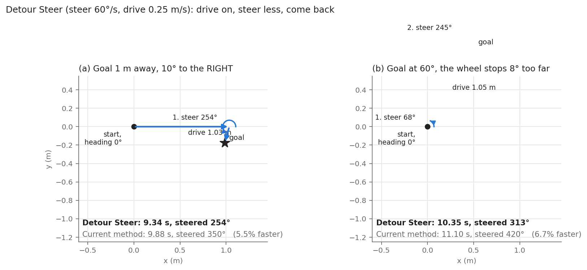
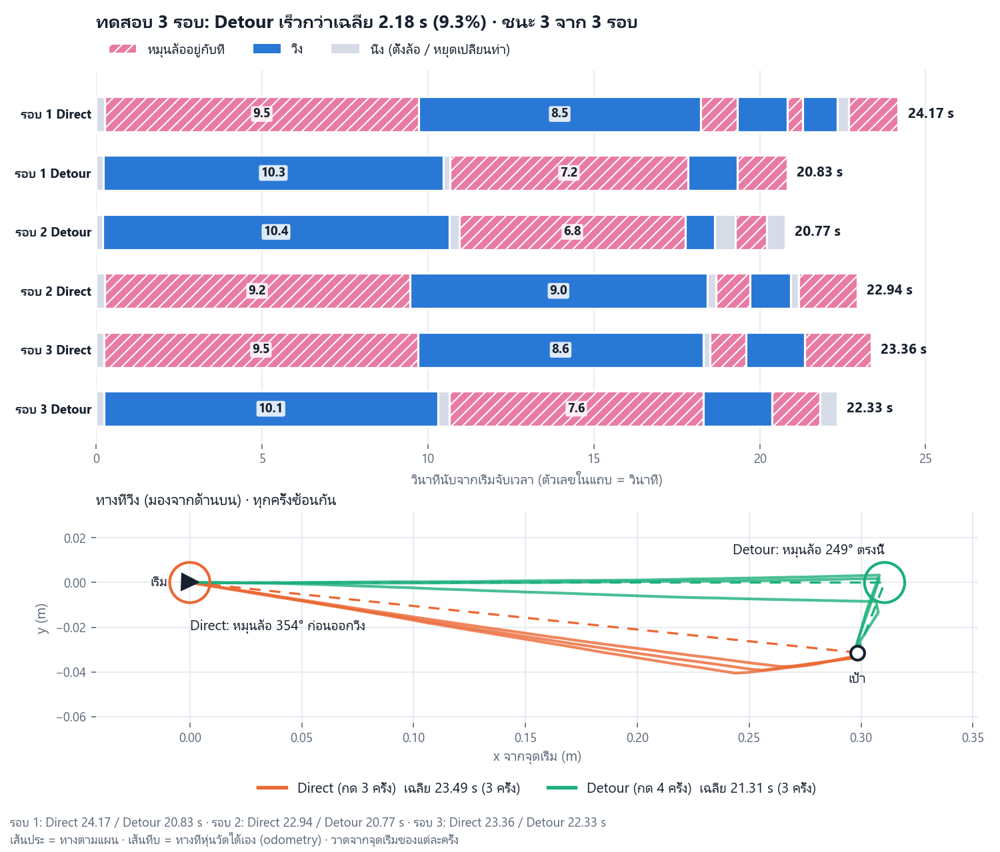

# Detour Steer แบบเข้าใจง่าย (สำหรับนำเสนอ)

เอกสารเต็ม: [`algorithm.pdf`](algorithm.pdf) · รายละเอียด + พิสูจน์: [`HW04_README_th.md`](HW04_README_th.md)

**สรุปประโยคเดียว:** หุ่นที่เลี้ยวได้ทางเดียว ถ้าเป้าอยู่ฝั่งที่ต้องหมุนล้อเกือบรอบ
ให้ **วิ่งไปก่อน เลี้ยวให้น้อยลง แล้วค่อยเข้าเป้า** และมีสูตรบอกว่าเลี้ยวเท่าไหร่ถึงเร็วที่สุด

---

## 1. ปัญหา

หุ่น `mor_luam` มี **มอเตอร์ตัวเดียว**
- มอเตอร์หมุนทางหนึ่ง = ล้อวิ่งไปข้างหน้า
- มอเตอร์หมุนอีกทาง = ล้อเลี้ยว (ผ่านคลัตช์ทางเดียว)

ผลที่ตามมา 3 ข้อ:
1. **เลี้ยวได้ทางเดียว**
2. **ต้องหยุดก่อน** ถึงจะเลี้ยวได้
3. **เลี้ยวระหว่างวิ่งไม่ได้**

ถ้าเป้าอยู่ "เลยทิศล้อไปนิดเดียว" ในฝั่งที่ล้อเลี้ยวไปไม่ถึง
วิธีเดิมต้อง **หมุนล้ออยู่กับที่เกือบเต็มรอบ** (เช่น 354°) ก่อนออกวิ่ง
บนหุ่นจริงใช้เวลาราว 9–10 วินาทีกับการหมุนอยู่กับที่

> **เปรียบเทียบให้เห็นภาพ:** รถที่เลี้ยวซ้ายได้อย่างเดียว ถ้าอยากไปทางขวา ต้องเลี้ยวซ้ายรวม 270°
> Detour Steer คือการหาว่า "ควรวิ่งต่อไปอีกเท่าไหร่ แล้วเลี้ยวเท่าไหร่" ถึงจะถึงเป้าเร็วที่สุด

---

## 2. ไอเดีย

เส้นตรง 2 เส้นที่ทิศต่างกันเกิน 180° ต่อกันแล้วไปถึงทิศไหนก็ได้ หุ่นจึงทำ 3 ขั้น:

1. **วิ่งตรงไปก่อน** `a` เมตร โดยไม่ต้องเลี้ยว
2. **เลี้ยวแค่** `β*` (น้อยกว่าการหมุนเกือบรอบ)
3. **วิ่ง** `b` เมตรเข้าเป้า

แลกกัน: **เลี้ยวน้อยลง** แต่ **วิ่งไกลขึ้นนิดหน่อย**



---

## 3. สูตร (หัวใจของอัลกอริทึม)

ข้อมูลที่ใช้: `φ` = ล้อต้องหมุนอีกกี่องศาถึงจะชี้เป้า, `d` = ระยะถึงเป้า, `v` = ความเร็ววิ่ง, `ω` = ความเร็วเลี้ยว

```
k  = (d·ω / v) · |sin φ|        ← ตัวเลขเดียวที่ตัดสินทุกอย่าง
β* = 360° − arccos(k − 1)       ← มุมเลี้ยวที่ดีที่สุด (ใช้เมื่อ k < 2)
a  = d · sin(β* − φ) / sin β*   ← ขาแรก
b  = d · sin φ / sin β*         ← ขาสอง
```

อ่านแบบง่าย:
- `k` เทียบ **"เวลาที่เสียเพราะวิ่งอ้อม"** กับ **"เวลาที่ได้คืนเพราะเลี้ยวน้อยลง"**
- `k ≥ 2` → อ้อมไม่คุ้ม → เลี้ยวตรงไปหาเป้าแบบวิธีเดิม
- `k < 2` → มีตัวเลือก `β*` แต่ต้องเทียบเวลารวมการหยุดก่อน ไม่ได้รับรองว่าอ้อมเร็วกว่า
- สุดท้ายเทียบเวลารวมสองแบบ แล้ว **เลือกอันที่เร็วกว่าเสมอ** จึง **ไม่มีทางช้ากว่าวิธีเดิม**
- คำนวณครั้งเดียวจบ O(1) ไม่ต้องลองทุกมุม เร็วกว่าการค้นหาราว 900 เท่า ESP32 ทำได้ทุกรอบ

**ตัวอย่างจริงบนหุ่น** (`d` = 30 ซม., `φ` = 354°):

| | วิธีเดิม | Detour Steer |
|---|---|---|
| ขั้นที่ 1 | หมุนล้อ 354° อยู่กับที่ | วิ่งตรงไป 31 ซม. |
| ขั้นที่ 2 | วิ่ง 30 ซม. เข้าเป้า | หมุนล้อ 249° |
| ขั้นที่ 3 | — | วิ่ง 3.4 ซม. เข้าเป้า |

---

## 4. ทำไมถึงถูกต้อง (พิสูจน์ 4 ข้อ แบบสั้น)

| ข้อ | ใจความ |
|---|---|
| T1 | ถ้า `φ ≤ 180°` เลี้ยวตรงไปหาเป้าดีที่สุดแล้ว อ้อมไม่ช่วย |
| T2 | ทางที่ดีที่สุดมีไม่เกิน 2 ขา (ขาแรกทิศเดิม ขาสองทิศ `β`) |
| T3 | สูตร `β*` คือจุดเวลาต่ำสุด **จุดเดียว** (อนุพันธ์ของเวลาเพิ่มขึ้นตลอด) |
| T4 | วางแผนใหม่หลังวิ่งขาแรก แผนไม่เปลี่ยน → ใช้แบบวางแผนใหม่ทุกครั้ง (closed loop) ได้ |

ตรวจด้วยคอมพิวเตอร์แบบลองทุกทาง (brute force) แล้ว ผ่านทั้งหมด

---

## 5. ทำให้ใช้ได้บนหุ่นจริง (Algorithm 1.6–1.7)

หุ่นวัดตำแหน่งจริงจากล้อ + ทิศตัวหุ่นจาก IMU ทุก 10 ms แล้ว **วางแผนใหม่ทุกครั้งที่ขยับเสร็จ**
มี 2 ขั้นที่ทำให้แม่นและนิ่ง:

**1.6 หยุดล้อก่อนมุมเป้าเล็กน้อยเสมอ (~2°)**
- ถ้าเลยมุมเป้า ล้อเลี้ยวได้ทางเดียว ต้องหมุนเพิ่มเกือบรอบ (เสีย ~10 วินาที)
- หุ่นจึงตัดไฟก่อน ปล่อยล้อไถลเข้าที่ และเรียนรู้เองว่าล้อไถลไปไกลแค่ไหน
- ไม่ดันล้อที่หยุดนิ่งแล้ว เพราะดันจากนิ่ง ล้อจะกระตุกเลยเป้า (วัดได้ 9°)

**1.7 หยุดเล็งใหม่ก่อนถึงเป้า**
- เลี้ยวระหว่างวิ่งไม่ได้ (มอเตอร์ตัวเดียว) ทางที่วิ่งจึงเบี้ยวได้นิดหน่อย
- ระหว่างวิ่ง หุ่นคำนวณว่าจะผ่านเป้าไปข้าง ๆ เท่าไหร่ ถ้าเกินระยะถึงเป้า หุ่นหยุดก่อนถึงเป้า
  แล้วเลี้ยวแก้แค่ ~18° แทนการหักกลับ ~90° หลังผ่านเป้า
- เพราะข้อ 1.6 หยุดก่อนเป้าเสมอ เป้าจึงอยู่ฝั่งที่ล้อเลี้ยวไปถึงได้ทุกครั้ง

---

## 6. ผลทดลองบนหุ่นจริง

**ทำให้ยุติธรรม:**
- โจทย์เดียวกันทุกครั้ง: เป้าห่าง 30 ซม. ที่ `φ` = 354° วัดจากทิศที่ล้อหันจริงหลังตั้งล้อเสร็จ
- ก่อนเริ่มจับเวลา หุ่นหันล้อไปทิศเริ่มเดียวกันและรอให้นิ่ง
- หุ่นจับเวลาเอง ขากลับไม่นับ
- สลับว่าแบบไหนวิ่งก่อนในแต่ละรอบ (แบตที่ลดลงจะไม่เข้าข้างแบบใด)

| รอบ | วิธีเดิม | Detour Steer | เร็วขึ้น |
|---|---:|---:|---:|
| 1 | 24.17 s | 20.83 s | 3.34 s |
| 2 | 22.94 s | 20.77 s | 2.17 s |
| 3 | 23.36 s | 22.33 s | 1.03 s |
| **เฉลี่ย** | **23.49 s** | **21.31 s** | **2.18 s (9.3 %)** |



**อ่านภาพนี้:**
- แถบ **วิธีเดิม** เริ่มด้วย **ชมพูยาว** = หมุนล้ออยู่กับที่ ~9 วินาทีก่อนออกวิ่ง
- แถบ **Detour** เริ่มด้วย **น้ำเงิน** = ออกวิ่งทันที แล้วชมพูช่วงหลังสั้นกว่า
- สรุป: Detour **เลี้ยวน้อยลง 3.8 s** แลกกับ **วิ่งเพิ่ม 1.2 s** → **เร็วขึ้นสุทธิ 2.2 s** และชนะทั้ง 3 รอบ
- ทุกครั้งถึงเป้าภายใน 2.5 มม.

ผลจากซิม 5,000 เป้า: Detour Steer ไม่ช้ากว่าวิธีเดิมเลยสักเป้า และยิ่งล้อหยุดคลาดมาก ยิ่งได้ประโยชน์มาก (สูงสุด 18.3 %)

---

## 7. ใช้ได้ดีเมื่อไหร่

- ได้เปรียบชัดเมื่อเป้าอยู่ **เลยทิศล้อไปนิดเดียว** (ต้องหมุนเกือบรอบ)
- เป้าทิศอื่น อัลกอริทึมเลือกเลี้ยวตรงเหมือนวิธีเดิมพอดี → **ไม่ช้ากว่า**
- หุ่นยิ่งเลี้ยวช้า หรือเป้ายิ่งใกล้ ยิ่งคุ้ม (`k` เล็กลง)
- ทางอ้อมวิ่งเลยเป้าไปก่อน จึงต้องมีที่ว่างรอบเป้า

---

## 8. งานที่ใกล้เคียง

| งาน | ต่างจากงานนี้ |
|---|---|
| กลไกมอเตอร์เดียววิ่ง+เลี้ยว (US 8,424,627 B2; Sekine & Mizuuchi 2022) | มีแต่กลไก ไม่มีวิธีวางแผนทาง |
| Dubins car ที่เลี้ยวได้ทางเดียว (Bakolas & Tsiotras 2011; Patsko & Fedotov 2018–2019) | รถเลี้ยว **ขณะวิ่ง** ไม่ใช่หยุดแล้วเลี้ยว |
| จัดลำดับจุดโดยคิดต้นทุนการเลี้ยว (angular-metric / quadratic TSP) | จัดลำดับจุด ไม่ได้หาทางอ้อมที่ดีที่สุด |
| ทำนายการไหลของมอเตอร์แล้วตัดไฟก่อน (US 8,571,394 B2) | แก้ด้วยการหยุดก่อน งานนี้แก้ด้วยวางแผนทางอ้อม |

พูดอย่างระวัง: **"ค้นแล้วไม่พบงานที่ให้สูตรนี้สำหรับหุ่นที่ต้องหยุดเพื่อเลี้ยวและเลี้ยวได้ทางเดียว"**
ไม่ใช่ "พิสูจน์แล้วว่าไม่มีใครทำ"

---

## 9. ลำดับการพูด (~5 นาที)

| ลำดับ | หัวข้อ | เวลา | ใช้อะไรประกอบ |
|---|---|---|---|
| 1 | ปัญหา: มอเตอร์ตัวเดียว เลี้ยวทางเดียว ต้องหยุดเลี้ยว | 40 s | ข้อ 1 + แถบชมพูยาวของวิธีเดิม |
| 2 | ไอเดีย: วิ่งก่อน เลี้ยวน้อยลง แล้วเข้าเป้า | 40 s | รถเลี้ยวซ้ายอย่างเดียว + `fig_path.png` |
| 3 | สูตร `k` และ `β*` | 60 s | ข้อ 3 |
| 4 | ทำไมถูกต้อง T1–T4 | 40 s | ตารางข้อ 4 |
| 5 | ทำบนหุ่นจริง 1.6–1.7 | 40 s | ข้อ 5 |
| 6 | ผล 3 รอบ | 60 s | ตาราง + `robot_3rounds.png` |
| 7 | งานใกล้เคียง + สรุป | 30 s | ข้อ 8 + ประโยคสรุปด้านบน |

---

## 10. คำถามที่อาจโดนถาม

| คำถาม | ตอบสั้น ๆ |
|---|---|
| ทำไมไม่เลี้ยวระหว่างวิ่ง | มอเตอร์ตัวเดียว ทางหนึ่งวิ่ง อีกทางเลี้ยว ทำพร้อมกันไม่ได้ |
| ทำไมไม่เลี้ยวอีกทาง | คลัตช์ทางเดียว ล้อหมุนกลับไม่ได้ |
| จะช้ากว่าวิธีเดิมได้ไหม | ไม่ได้ เพราะเทียบเวลาแล้วเลือกอันที่เร็วกว่าเสมอ (เป้าทิศอื่นทำเหมือนเดิมพอดี) |
| เทียบยุติธรรมไหม | โจทย์เดียวกัน ตั้งล้อก่อนจับเวลา วัดเป้าจากทิศล้อจริง สลับลำดับ หุ่นจับเวลาเอง |
| ทำไมบนหุ่นจริงต่างกันมากกว่าที่สูตรคาด | สูตรคาด 1.4 s ได้จริง 2.2 s เพราะวิธีเดิมหมุนเกือบรอบแล้วต้องแก้ตอนท้ายมากกว่า |
| 3 รอบพอไหม | ชนะครบ 3 รอบ และซิม 5,000 เป้ายืนยันทิศทางเดียวกัน ถ้าจะอ้าง % แม่น ๆ ควรทดสอบเพิ่ม |
| หุ่นรู้ได้ไงว่าล้อหันไปเท่าไหร่ | เซนเซอร์มุมล้อ AS5600 + IMU ทุก 10 ms แล้ววางแผนใหม่จากค่าจริง |
| ในเอกสารบอกทวนเข็ม แต่หุ่นเลี้ยวทวนเข็ม | เป็นภาพสะท้อนกระจก มุมวัดตามทิศที่ล้อเลี้ยว สูตรเหมือนกันทุกตัว |


## อัปเดตกรอบและเส้นทางยาว (27 ต.ค. 2026)

หุ่นเลี้ยว **ทวนเข็มนาฬิกา** เมื่อมองจากด้านบน: หัวล้อ 90° ชี้ +y (ซ้าย), เป้าที่เยื้องขวา 6° จึงมี φ=354°
โค้ดทั้งหมดและ pseudocode ใช้กรอบนี้ตรงกันแล้ว โดยไม่เปลี่ยนสูตร β*, a, b หรือข้อพิสูจน์

เมื่อใช้ความเร็วจริง 0.03 m/s และแบบจำลองเลี้ยว 35°/s เป้าจุดเดียวห่าง 2 m อาจทำให้ Detour เลือก Direct
จึงใช้เส้นทางขาไปรวม 2 m แบ่ง 7 ช่วงสั้น ผ่านจุดเดียวกันทั้งสองแบบ ให้เห็นลำดับการเดินกับเลี้ยวต่างกัน
แบบจำลอง: Direct 137.82 s; Detour 110.52 s และขับอ้อม 4 ช่วง ตัวเลขนี้ไม่ใช่ผลทดลองหุ่นจริง
ขากลับประมาณ 1.96 m ไม่รวมเวลาเปรียบเทียบ 3 รอบคู่หมายถึง 6 ครั้ง

รายละเอียดและวิธีทดสอบ: [คู่มือ HW04](../../aut_HW_04_detour_steering/README.md)
